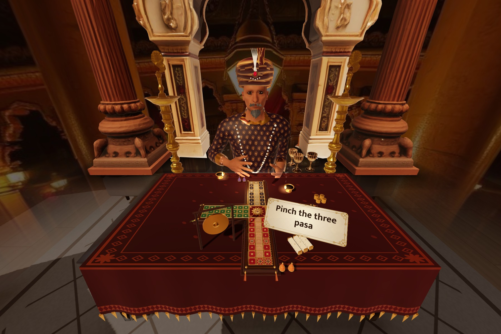
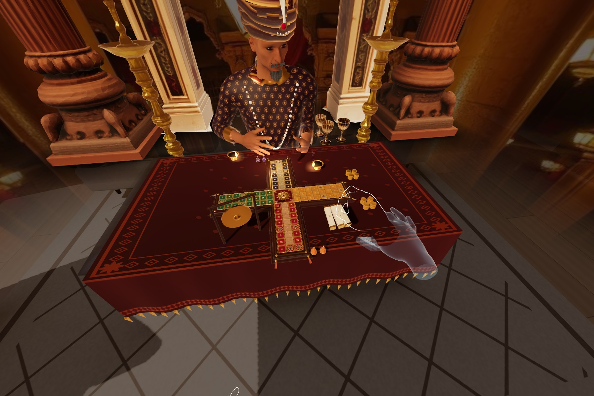
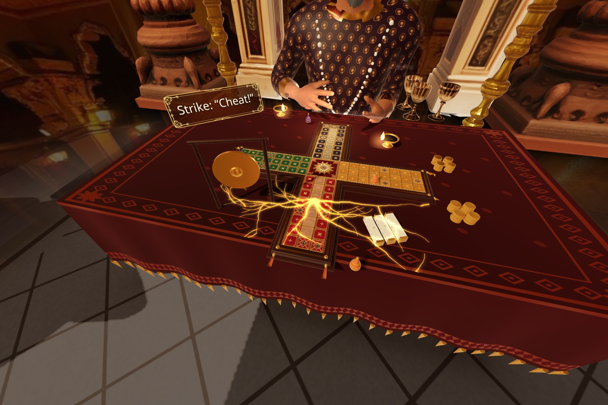
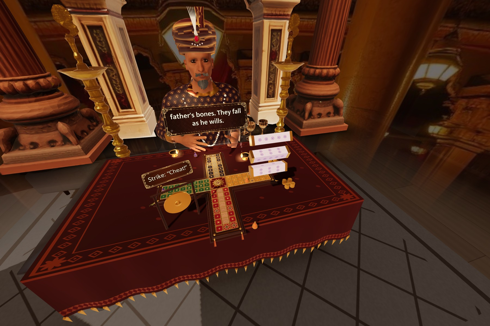
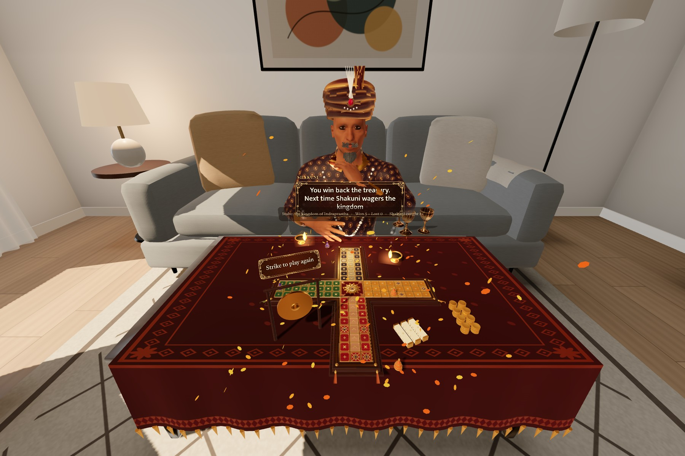

# Bones of Fate

*A game of chausar against Shakuni, on your real table.*

**Mixed reality · hands only · seated · Meta Quest Browser (WebXR)**

**Play:** open **https://bones-of-fate.vercel.app** in Quest Browser on a Quest 3 or 3S, then tap *Enter XR*.



| | |
|---|---|
|  |  |
|  |  |

*Screenshots from the IWSDK emulator (`tools/gallery/shoot.py`).*

A carved chausar board rises out of your real table. Across it sits the spirit of **Shakuni**, the most famous dice cheat of the Mahabharata. You throw the long *pasa* dice with a real throw of your hand and move your pieces with a pinch.

**Cheating is the game.** While Shakuni looks away, lower the dice beneath your real table's edge to swap in loaded ones, or poke a settled die to tip it onto a better face. If his blazing eyes catch you, your side of the board cracks open and divine light reveals the true roll. He cheats too: watch his ghostly hand. If it dips below the table, strike the gong to accuse him.

- **Track:** Gaming
- **Special awards it targets:** Boldest Original Concept (cheating by hand only works with tracked hands and a real table), Best Reason to Come Back (the stakes climb between sessions), Best First Five Minutes.
- **Tech:** IWSDK 1.1.0 (three.js + ECS), WebXR `immersive-ar` with hand tracking, plane detection and depth occlusion; a realistic rigged character driven by procedural animation; static hosting on Vercel.

---

## How to play (about 3 minutes)

| Do this | With your hands |
|---|---|
| Place the board | Look at your table; a gold cross outline snaps onto it. **Pinch** to set it. With no table detected, hold a hand just above your table and pinch. |
| Throw | **Pinch** the three pasa, shake, then **open your fingers** to throw. |
| Move | If both pieces can move, **pinch** (or poke) the glowing piece. |
| Cheat 1: the swap | While holding the dice, lower your hand **below the table edge** for half a second. The pasa come back loaded (best possible throw). |
| Cheat 2: the nudge | After the throw, **poke** a die to tip it a quarter turn onto the next face. |
| Accuse Shakuni | **Poke the gong** (near-left corner) after his throw. If he cheated, his side cracks, his turn is undone and his leading piece falls back 12 squares; if he didn't, you lose your next throw. |
| Move the board | **Pinch with both hands** for 1.5 s. |
| Play again | Strike the gong after the match. |

**Rules ("short chausar"):**
- 3 pasa with faces 1, 2, 5 and 6; each throw moves one piece by the total.
- 2 pieces each, which run one anticlockwise lap of the cross, then up your own middle column into the *char koni* (centre).
- **First piece home wins**, or **bankrupt him**: whoever runs out of gold loses (see the wager below).
- Landing on an enemy piece outside a castle square sends it back to start.
- A capture or a triple earns another throw.

**Shakuni's gaze is the stealth loop:**
- Red, blazing eyes mean he's watching.
- When he turns to the court, his eyes dim to embers.
- A flicker and a warning tone mean he's turning back.
- Getting seen means you're caught: your throw is void and your leading piece falls back 12 squares.
- Cheating unseen still raises his **suspicion** meter (under his chin). At high suspicion he can call it on luck alone.
- His second throw always cheats, so every player learns his tells early. **Two tells:** his hand dips below the table before a loaded throw, and he usually **names the total while the dice are still in the air**. He only knows it because he rigged it.
- **The first time you catch him**, his dice rise in front of you and the legend is told: the old tellings say they were carved from his father's bones. Touch one.

**The wager is on the table:** eight stacks of gold mohurs beside the board, half each. A capture sweeps a stack to the captor; getting caught costs you one; catching him wins one. **A side with no gold left loses the match** (like Yudhishthira, with nothing left to wager); otherwise the first piece home wins and takes the rest. Caught pieces lose 12 squares rather than going back to the start, so cheating costs ground but matches always end. The match ends with a closing reflection on how you played.

**Progress (saved in the browser):** each win raises the stake one step, following the Sabha Parva: a chest of gold → the royal chariot → a thousand elephants → the army → the treasury → the kingdom. The ledger shows wins, losses and how often you've caught him.

---

## Run it

```bash
npm ci                 # Node ≥ 20.19 (see .nvmrc)
npm run setup          # once per machine: MCP configs + IWSDK reference index
npm run dev            # HTTPS dev server + emulator on https://localhost:8082
npm run typecheck && npm run build
```

- **Port 8082** (not the scaffold's 8081), so Bones of Fate can run alongside the other projects' dev servers.
- **Quest over USB from Linux:** `adb reverse tcp:8082 tcp:8082`, then open `https://localhost:8082` in Quest Browser.
- **Desktop keys** (browser preview and emulator):
  - `Space` throw, `U` load the dice, `F` flip a die, `1`/`2` pick a piece, `G` gong, `N` new game, `M` mute.
  - Dev builds only: `K` makes Shakuni look away, `W`/`L` put a piece near home, `X` crack, `V` victory.

## Tests

```bash
npm test               # rules + dice physics, headless (no browser)
npx @iwsdk/cli dev up --ai-mode agent && npm run test:xr   # 44 XR checks with emulated hands
```

| Suite | What it proves |
|---|---|
| `scripts/sim-rules.ts` | The path is 75 squares with legal (incl. diagonal) steps. 2,000 AI-vs-AI games average about 17 throws, with balanced wins. Whole matches with his cheating, your cheating, catches and the gold: the 12-square penalty plus the gold ending halves match length under heavy cheating (worst case under 100 throws, was over 300). Regression: a seat-0 win keeps the turn. |
| `scripts/sim-dice.ts` | 300 hand throws: all settle (median 1.1 s), **forced faces are honoured 150/150** (loaded dice), and about 97% land fully in the throwing court. |
| `scripts/e2e/xr_core.py` | Hands-only in IWER (`immersive-ar`, Quest 3 profile): table detection → pinch to place → pinch to skip the intro → pinch-pickup → throw → reveal → seen swap is caught → poking the gong catches Shakuni's scripted cheat → play resumes. |
| `scripts/e2e/xr_cheats.py` | Unseen swap gets away; wrong accusation forfeits your throw; flip-poke registers; reaching the centre wins; striking the gong restarts. |
| `scripts/e2e/xr_gold.py` | Running out of gold ends the match (Shakuni wins by gold) mid-race, with a closing reflection; the gong restart deals the gold back out 4 and 4. |
| `scripts/e2e/xr_hands.py` | Hand-tracking guardrails: a lost hand doesn't throw the dice, a passing fingertip doesn't move a piece, take-back works, waving gets a reply. Ghost-hand demos, Shakuni's early call, the dice legend, gold changing hands and the closing reflection are checked in the other suites. |

`test:xr` calls `python3`. On Windows run `python scripts/e2e/run_all.py`.

## How it's built

```
src/game/
  rules.ts     pure rules: paths, moves, captures, AI scoring, loaded throws (no three.js)
  dice.ts      custom rigid-body pasa sim in board space; settle step rolls each bar onto a chosen face
  hands.ts     WebXR joints → pinch hysteresis, release velocity (least squares, 140–40 ms window), tracking-loss grace
  board.ts     procedural cross board: embroidered cloth with glinting zari (metal/rough/bump masks), lacquered pieces, gong, tassels
  shakuni.ts   Shakuni controller: gaze state machine, hand path, suspicion; drives the realistic human (fallback: procedural bust)
  human.ts     realistic Shakuni runtime: seated cross-legged (leg IK), two-bone arm IK, head look, blinks, expressions, jaw talk, beard stroke
  seat.ts      his gaddi (velvet divan + bolster), sized to your real table's height
  palace.ts    the dice hall of Hastinapur: 360° dome that replaces your walls, fades out below the horizon (your table stays real)
  ui.ts        text system: dialogue subtitles in their own region, instruction hints anchored to objects, paged ≤2 lines
  text.ts      Canvas2D labels (Devanagari-safe), fit-to-card (never clips), Mukta UI + Rozha One display
  lighting.ts  one shadow-casting key light aimed at the board, re-rendered only when something moves
  ambience.ts  two brass diyas (flicker, warm light, embers, smoke), moods; room dimmer
  juice.ts     pooled particle bursts, landing rings, reward waves, squash-and-stretch hops
  fx.ts        crack → kintsugi gold, light pillars, sparks, marigold petals
  audio.ts     all sound synthesised in WebAudio (clacks, rattle, gong, crack, choir, conch, tanpura drone)
  save.ts      localStorage ledger + stake ladder
  director.ts  the IWSDK system: placement → intro → turns → cheats → accusation → game over
tools/
  shakuni/     build_shakuni.py + costume.py: headless Blender + MPFB → public/models/shakuni.glb
  freegen/     gen.py (FLUX → TRELLIS props, needs a free HF token), palace.py (FLUX panorama)
  meshy/       optional paid route (unused)
```

**Key decisions**
- **A real person across the table.** Shakuni is a MakeHuman/MPFB human (CC0 output) with a costume built in code (turban wound from one zari-bordered band, angarkha + dhoti cut from his own body mesh, hair-card goatee and twirled moustache, pearls, sarpech). He's driven procedurally: breathing, blinking, expressions (smirk, squint, laugh, sneer), head/eye contact, jaw while speaking, real arms that reach for, shake, hide and throw the dice, and a beard stroke between turns. He sits cross-legged on a gaddi whose height follows your table, and **Quest depth occlusion** lets your real table hide whatever of him is behind it.
- **No Havok for the dice** — custom sim so the game can force a face invisibly (loaded dice); honest throws keep their natural face.
- **Your real table is part of the mechanic** (hide the dice below its edge), so passthrough is purposeful; the **room transforms** into the Hastinapur hall around it.
- **Text follows Meta's comfort rules** (`hz-immersive-designer`): ≥1.5° glyphs, sans-serif body (Mukta), ≥4.5:1 contrast, ≤2 lines per page; dialogue and instructions live in separate regions so nothing overlaps.
- **Placement fallback chain**: labelled table in front of you → hand placement → virtual spot; two-hand pinch re-places.
- **Performance**: ~85–90 draw calls in desktop view, one 1024² shadow map updated only on motion, no post-processing, foveation 0.5, 72 Hz target. Character 2.8 MB (WebP textures; no Draco — it corrupted small skinned meshes).

## Credits
- **Shakuni's body**: generated with MakeHuman/MPFB 2 (the tool is GPL; generated humans and the MakeHuman system assets — skin, eyes, brows, lashes — are CC0). Costume, hair and animation are our own code.
- **Palace backdrop**: painted with FLUX.1-schnell (Apache-2.0) from our prompt (`tools/freegen/palace.py`).
- **Brass goblets**: Poly Haven, CC0.
- **Ghost hand** (shows the cheats): [WebXR Input Profiles](https://github.com/immersive-web/webxr-input-profiles) generic hand mesh, MIT; pinch and point hand shapes from IWER (MIT, Meta).
- **Fonts**: Rozha One, Tiro Devanagari Hindi, Mukta — SIL Open Font License (Google Fonts).
- **Story**: inspired by the Sabha Parva; "Lo, I have won!" and the order of stakes from K. M. Ganguli's public-domain translation.
- **Code**: IWSDK (MIT, Meta). Particle-burst and reward-wave ideas adapted from Meta ProjectFlowerbed (MIT), attributed in `juice.ts`. Everything else written for this project.

Research notes: [docs/RESEARCH.md](docs/RESEARCH.md). Submission kit: [docs/SUBMISSION.md](docs/SUBMISSION.md). Test and judging matrix: [docs/TESTING.md](docs/TESTING.md).
